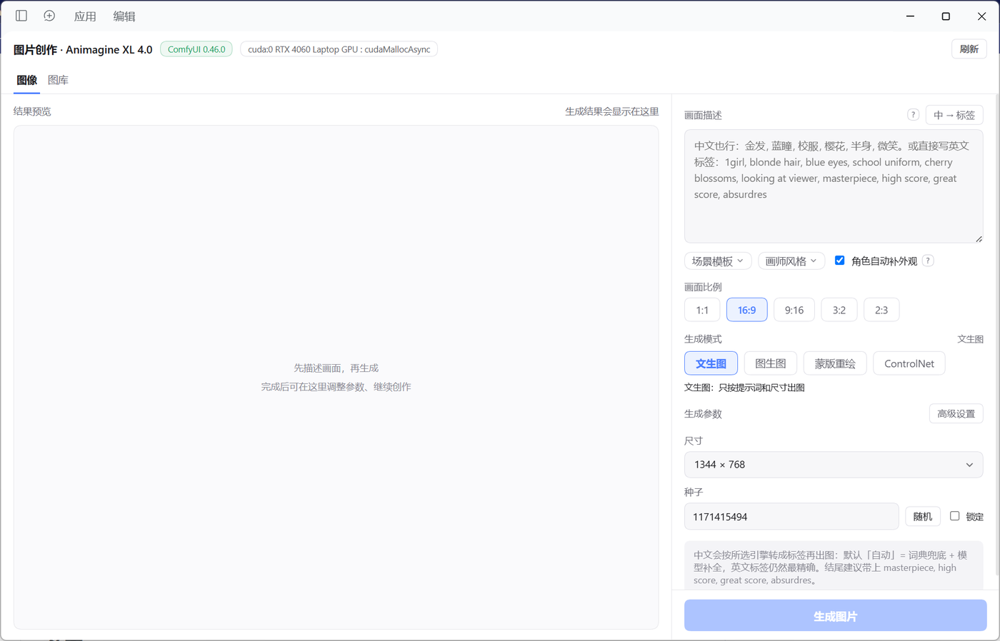
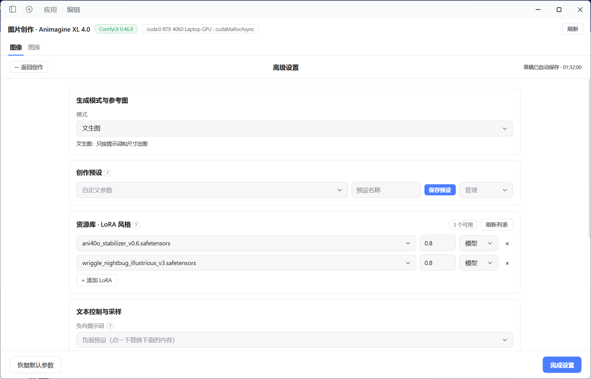

# 绘梦 · Animagine（dsh-anima-studio）

[](https://github.com/WenhuarenNB/dsh-anima-studio/actions/workflows/ci.yml)


[DeepSeek Harness](https://github.com/deepseek-ai)（dsh）插件：把本地 **Animagine XL 4.0 Opt**（SDXL 微调）跑在 **ComfyUI** 上，给你一个能写中文提示词、调参数、翻图库的工作台，并让 Agent 能直接生成图片。

- 中文描述 → danbooru 英文标签：**3700+ 离线映射 / 507 个角色**，切不干净的句子才交给 dsh 自带模型
- 文生图 / 图生图 / 蒙版重绘 / ControlNet 四种模式，创作页跟着模式变
- 26 个场景模板、106 个画师风格、负面预设、LoRA 叠加（最多 8 个）
- 参数自动存草稿，重启不丢；图库支持搜索、星标、归档
- 四个对话工具：生成 / 查状态 / 查图库 / 列 ControlNet

> 只支持本机 ComfyUI，不含模型文件，不联网出图（除了你自己配置的模型通道）。

## 截图

| 创作页 | 高级设置 |
| --- | --- |
|  |  |

左：中文描述 → 标签、场景模板、画师风格、角色自动补外观，四种模式随时切换；右：创作预设、LoRA 叠加（最多 8 个）、负面预设与采样参数。
截图环境：ComfyUI 0.46.0 + RTX 4060 Laptop + Animagine XL 4.0 Opt。

## 安装

**前提**：已装好 dsh（`dsh` >= 0.2.2-rc.1）。

```bash
# 1. 放进 dsh 的 profile（示例路径，以你的 profile 为准）
git clone https://github.com/WenhuarenNB/dsh-anima-studio.git \
  ~/.dsh/profiles/desktop/node_modules/dsh-anima-studio
```

然后让 profile 认到它 —— 编辑 `~/.dsh/profiles/desktop/package.json`：

```jsonc
{
  "dependencies": {
    "dsh-anima-studio": "link:./node_modules/dsh-anima-studio"
  },
  "dsh": {
    "profile": {
      "bundles": [
        // …其它 bundle
        "dsh-anima-studio"
      ]
    }
  }
}
```

重启 dsh，侧边栏出现「图片创作」即可。

## 拿到 ComfyUI 与模型（三种方式，选一种）

插件不含权重，也**不会自动拉起 ComfyUI**：没启动时页面顶部显示「ComfyUI 离线」，生成会直接报连接错误而不是静默失败；想让它顺手拉起，配置 `startScript` 指向你的启动脚本，插件会 spawn 它并轮询端口。

**方式 A · 已经装过 ComfyUI（最常见）**

把 `animagine-xl-4.0-opt.safetensors` 放进 ComfyUI 的 `models/checkpoints/` 即可。不知道放哪就让插件下：页面横幅「准备环境 → 下载模型到 ComfyUI」会从 Hugging Face 拉（约 6.9 GB，**断点续传**，官方源失败自动换 `hf-mirror.com`），进度/速度/剩余时间实时显示、可取消，落到 `comfyRoot/models/checkpoints/`；配置里写一下 `comfyRoot` 指向你的 ComfyUI 根目录就行。

**方式 B · 让插件拉 ComfyUI（Windows / NVIDIA）**

```powershell
cd dsh-anima-studio
powershell -ExecutionPolicy Bypass -File .\scripts\install-comfyui.ps1 -Port 8190
```

脚本会：检查 python（**不强制 git**：有 git 就浅克隆，没有就下 zip 解压）→ 建 venv → 装 CUDA 版 PyTorch 与依赖 → 生成 `launch-comfy.ps1` → 打印要填的配置。

常用参数：

| 参数 | 作用 |
| --- | --- |
| `-DryRun` | 只打印路径规划，不动磁盘（先看看它会做什么） |
| `-SkipDeps` | 不装 PyTorch/依赖，只准备 ComfyUI 与启动脚本 |
| `-SkipVenv` | 不用 venv，直接装进 `-Python` 指定的解释器（venv 装不上时的退路） |
| `-CudaIndex cu121/cu124/cpu` | 选 CUDA 轮子或纯 CPU |
| `-PipMirror <url>` | 国内 pip 镜像 |
| `-SourceZip <zip 或直链>` | 离线/内网时用本地包或自建镜像 |

装完在插件页点「下载模型」即可出图。

**方式 C · 全手动**：官方 ComfyUI portable + 自己下 `animagine-xl-4.0-opt.safetensors` 放进 `models/checkpoints/`。

### 为什么仓库里不带权重

- **GitHub 放不下**：单文件 100 MB、Release 单文件 2 GB 的硬限制，SDXL fp16 权重是 6.9 GB
- **许可要求**：Animagine XL 4.0 采用 [FAIPL-1.0-SD](https://freedevproject.org/faipl-1.0-sd/)，再分发需要随附许可证与署名，做成"下载即同意"更干净

所以策略是：**代码开源、权重按需现下**。

## 页面里能做什么

顶部两个标签：**图像**、**图库**。

### 图像（创作）

左右分栏：

| 区域 | 内容 |
| --- | --- |
| 左：结果预览 | 生成结果、进度、尺寸与种子信息；点图可放大 |
| 右：画面描述 | 正向提示词、中 → 标签、场景模板、画师风格、角色自动补外观 |
| 右：画面比例 | 1:1、16:9、9:16、3:2、2:3 五档快速切换 |
| 右：生成模式 | 文生图 / 图生图 / 蒙版重绘 / ControlNet，切换后下方出现对应控件 |
| 右：生成参数 | 「高级设置」入口、尺寸下拉、种子（随机/锁定） |
| 右：底部 | 生成图片按钮；生成中可取消 |

#### 中文提示词

Animagine 是 SDXL 架构，文本编码器是英文 CLIP，中文会被切成无意义字节，基本等于空提示词。
所以插件做了两层转换：

| 引擎 | 行为 | 适用 |
| --- | --- | --- |
| 词典（`tags.js` + `tagdata.js`，3700+ 条映射） | 最长匹配把中文换成 danbooru 标签，颜色+物件组合也能识别（`红色眼睛` → `red eyes`） | 短语堆叠、角色名，完全离线 |
| 模型（`translate.js`，走 DSH 的 `ctx.llm`） | 把整段中文描述交给本机模型，按系统提示拆成 danbooru 标签 | 成句描述、口语化动作 |
| 自动（**固定，无需选择**） | 先跑词典；只有**出现未收录字**或词典没结果时才叫模型 | 日常使用，省 token 又快 |

- 点「画面描述」右侧的 **中 → 标签**；引擎固定为「自动」，界面上不再需要选引擎或选模型
- 直接点「生成图片」也会自动转换：只要检测到汉字，先转成标签再提交，文本框里会显示转换结果和用了哪个引擎
- 已经是英文的部分原样保留，中英混写没问题
- 模型失败（没登录、超时、通道不支持）会自动退回词典结果，并在提示里写清失败原因

#### 离线词库（tagdata.js）

词库来自 Prompt Forge v3.0 的标签库，抽成 `tagdata.js` 后由 `tags.js` 使用：

| 内容 | 规模 | 说明 |
| --- | --- | --- |
| 中文 → 标签映射 | **3700+ 条** | 32 个分类（人数/发色/表情/姿势/服装/场景/天气/道具/画师/成人等），按最长匹配切词 |
| 角色名 | **507 个** | 中文名与「中文名（作品）」都能命中，如 阿米娅 → `amiya (arknights)` |
| 场景预设 | 26 个 | 已随包提供，供后续「场景模板」使用 |

清洗规则（生成时一次性处理）：

- 单字键（如「龙」「手」）不参与匹配，避免在长句里误命中
- 纯拉丁「中文键」（画师名）跳过
- 超过 5 个词的整句描述丢弃（那是给模型引擎的活，不是 danbooru 标签）
- 「穿着→wearing」这类非标签词条丢弃，同时把「穿着/戴着/身穿」等并入虚词表，不计入丢字
- 同一中文键多来源时：手写词条 > 词库分类标签 > 别名 > 角色名（所以「极光 → aurora」不会被同名角色抢走，「少女 → 1girl」也不会被口语写法盖掉）

**角色自动补外观**：创作页「画面描述」下方有一个勾选框（和场景模板、画师风格同一行）。勾上后，命中的角色会顺带补它的发色/瞳色/服装等外观标签（如 阿米娅 → `amiya (arknights), brown hair, ponytail, blue eyes, rabbit ears, ring, hood, black pantyhose, small breasts`）；不勾只输出角色标签本身。开关状态随草稿保存。

#### 场景模板 / 画师风格 / 负面预设

三样都来自同一个词库（`GET /api/anima-studio/library`，进页面拉一次，静态数据）：

| 位置 | 控件 | 行为 |
| --- | --- | --- |
| 创作页 · 画面描述下方 | **场景模板** | 26 个模板（雨中天台 / 赛博夜街 / 神社参拜 / 魔法少女 …），点一个把整套标签**追加**到提示词，已存在的自动去重 |
| 创作页 · 画面描述下方 | **画师风格** | 106 个画师（`wlop`、`makoto shinkai`、`artgerm` …），中文名作副标题，点一个追加该画师标签 |
| 高级设置 · 负向提示词 | **负面预设** | 清空（用模型推荐）/ 通用画质+解剖 / 手部与解剖 / 文字水印 / 词库全部负面（134 条），选中即替换文本框内容 |

两个模板选择器都是浮层面板（带搜索框，超过 8 项时出现），点外面或 Esc 收起。

#### 转换会跟着生成模式收敛

同一个转换引擎，在四种模式下的「该转多少」并不一样——文生图要从零描述整幅画面，其余模式画面已经由参考图或控制图决定了，再把整个场景复述成标签只会跟图片打架。所以 `/translate` 现在会收到 `mode`，服务端按模式给模型追加不同的规则：

| 模式 | 转换时的额外规则 | 结果 |
| --- | --- | --- |
| 文生图 | 无，完整拆解人数/角色/发色/服装/动作/镜头/背景 | 全套标签 |
| 图生图 | 只输出你要求改动或强调的部分，不复述参考图里已存在的主体/背景/视角；「把帽子改成红色」→ `red hat` | 短、聚焦改动 |
| 蒙版重绘 | 只描述白区里要画什么，不提蒙版外的内容 | 最小标签集 |
| ControlNet | 不输出视角/姿势/构图标签（构由图决定） | 只留内容、服装、颜色、风格 |

另外非文生图模式下，模型爱自作主张补的 `masterpiece / best quality / highres / absurdres` 这类质量标签会被自动丢掉（你在原文里写了「杰作 / 高清」才保留）。转换失败时：文生图会拦住并提示，其他模式因为靠参考图出图，会提示一句「按原文提交」后继续，不会把你卡住。

请求示例：

```json
POST /api/anima-studio/translate
{ "text": "把帽子改成红色", "mode": "img2img", "appearance": false }
// -> { "text": "red hat", "engine": "llm", "mode": "img2img", "matched": 1 }
```

三个字段：`text` 原文、`mode` 生成模式（决定收敛程度）、`appearance` 是否给角色补外观。`engine` 可选（`auto` 默认 / `dict` / `llm`），界面固定发 `auto`，curl 调试时可以强制走词典或模型。

### 高级设置（独立页面）

从「生成参数 → 高级设置」进入，左上角「← 返回创作」或底部「完成设置」返回。五张卡片：

1. **生成模式与参考图** — 文生图 / 图生图 / 蒙版重绘 / ControlNet 四模式；参考图/控制图可从图库选或上传，降噪强度、蒙版外扩、ControlNet 模型与强度
2. **创作预设** — 把当前参数存成命名预设，可套用、删除（存在本机浏览器 localStorage）
3. **资源库 · LoRA 风格** — 添加/移除 LoRA，权重 0–2，最多 8 个，可切换「仅模型 / 模型+CLIP」
4. **文本控制与采样** — 负向提示词、CFG 引导强度、调度器
5. **采样与尺寸** — 步数、采样器、批量、尺寸

底部还有「恢复默认参数」。

**创作页也会跟着模式走**：面板里有一块「生成模式」，四颗胶囊可随时切换，选中后立刻出现对应控件——

| 模式 | 创作页多出来的东西 | 生成按钮 |
| --- | --- | --- |
| 文生图 | 只有提示词与尺寸 | 生成图片 |
| 图生图 | 参考图（图库选 / 上传）+ 缩略图 + 降噪强度；尺寸置灰（跟随参考图） | 图生图 |
| 蒙版重绘 | 再叠一层蒙版图（上传 + 缩略图）+ 蒙版外扩 | 蒙版重绘 |
| ControlNet | ControlNet 模型 + 控制图（图库 / 上传）+ 控制强度 | ControlNet 生成 |

缺参考图 / 缺蒙版 / 缺模型时点生成会在提交前拦下来并提示原因，不会先排队再失败。高级页和创作页改的是同一份参数，两边实时同步。

界面细节：

- 所有下拉都是自绘菜单（圆角浮层、选中打勾、危险项标红、上下自动翻转），不用系统原生弹窗
- 每个「?」提示也是自绘气泡：悬停 / 键盘聚焦 110ms 后浮出，圆角卡片 + 小箭头，靠近窗口边缘自动换对齐方向，按 Esc 或移开即收起，不再弹系统那种方框 tooltip
- 保存 / 删除 / 套用预设、恢复默认参数、刷新 LoRA 列表都会在右下角弹一条轻提示，**5 秒后自动消失**，点击可立即关闭，不再挤动页面布局
- **参数会自动存成草稿**（localStorage，不含 base64 图片），关掉 dsh 再打开，提示词、尺寸、采样和 **LoRA 叠层都会原样恢复**
- LoRA 列表在进入页面时自动拉取；ComfyUI 还在冷启动时会每 5 秒重试，并把上一次的结果缓存下来，重启后立刻可选，也可以在卡片右上角手动「刷新列表」
- 「+ 添加 LoRA」会自动挑一个还没用上的文件，不再总是塞第一个

### 图库

- 顶部搜索框按提示词过滤
- 右上筛选：全部作品 / 星标 / 已归档
- 每张卡片：★ 星标、复用参数、归档（可取消）、删除（彻底删除，含确认）
- 已归档的作品不出现在「全部作品」里，只在「已归档」筛选下可见
- 空状态带「+ 创作第一张」按钮

## 对话里能做什么

四个工具：

- `anima_generate_image` — 提交生成，参数与页面一致（prompt / negative / width / height / steps / cfg / sampler / scheduler / seed / batch / lora_names / lora_weights / lora_modes，以及 mode / denoise / ref_* / mask_* / control_* / controlnet / control_strength / grow_mask_by），完成后把图片附到对话
- `anima_image_status` — 按任务 ID 查状态和参数，超时后取回原任务（含图片）
- `anima_image_gallery` — 列出最近生成记录
- `anima_controlnets` — 列出 ComfyUI 里可用的 ControlNet 模型

提示词要按标签写，不是自然语言：

```
1girl, silver hair, blue eyes, school uniform, cherry blossoms, looking at viewer,
upper body, outdoors, masterpiece, high score, great score, absurdres
```

## 已知边界

- 图生图/蒙版重绘需要参考图（从图库选或上传），蒙版重绘还需一张蒙版图（白色区域会被重绘）。ControlNet 需要在 ComfyUI 的 `models/controlnet` 目录放好对应模型。
- 一次只跑一个任务，后续任务排队，避免 8 GB 显存被打爆。
- 取消生成会中断 ComfyUI 当前执行的任务，并把该任务标记为「已取消」。
- LoRA 列表来自 ComfyUI 的 `LoraLoader` / `LoraLoaderModelOnly` 节点，放文件到 `ComfyUI\models\loras\` 后点卡片里的「刷新列表」即可，不必等整页刷新。
- 生成中和 Qwen 网关互斥：两边抢同一块显存，先停一边。

## 配置项

写在 profile 的 `cordis.patch.yml` 的 `anima-studio` 段：

| 键 | 默认值 | 说明 |
| --- | --- | --- |
| `baseURL` | `http://127.0.0.1:8190` | ComfyUI 地址 |
| `checkpoint` | `animagine-xl-4.0-opt.safetensors` | checkpoints 目录里的文件名 |
| `timeoutMs` | `900000` | 单任务超时 |
| `root` | `$DSH_HOME/anima-studio` | 任务记录与图片存放目录 |
| `autoStart` | `true` | ComfyUI 没起来时是否尝试拉起 |
| `startScript` | 空 | 拉起 ComfyUI 的脚本；留空 = 只轮询，不负责启动 |
| `comfyRoot` | 空 | ComfyUI 根目录；填了才能定位 `models/checkpoints` |
| `setupRoot` | `$DSH_HOME/anima-studio/setup` | 一键安装脚本的默认安装位置 |
| `modelSource` | `auto` | 模型下载源：`hf` / `mirror` / `auto`（先官方后镜像） |
| `modelUrl` | 空 | 自定义模型直链（留空用内置地址） |
| `defaultLoras` | 空 | 默认 LoRA，如 `stabilizer.safetensors:0.8` |
| `llmProvider` / `llmModel` | `deepseek-account` / `deepseek-flash` | 中文转换兜底用的模型通道 |
| `llmTimeoutMs` / `llmMaxTokens` | `30000` / `320` | 模型转换的超时与长度 |
| `llmSystemPrompt` | 内置 | 想换转换风格时整段替换（模式规则仍会追加） |

```yaml
- id: anima-studio
  name: dsh-anima-studio
  config:
    baseURL: http://127.0.0.1:8190
    checkpoint: animagine-xl-4.0-opt.safetensors
    autoStart: true
    startScript: ''
    defaultLoras: "ani40o_stabilizer_v0.6.safetensors:0.8"
```

## 项目结构

```
index.js            服务端：ComfyUI 客户端、任务队列、HTTP 路由、4 个对话工具
setup.js            环境准备：模型下载（断点续传/换镜像）、目录推导、就绪检查
client.js           前端：绘图工作台（自绘下拉/气泡/面板都在这里，无构建步骤）
tags.js             中文 → 标签匹配：最长匹配 + 颜色×物件组合 + 虚词表
tagdata.js          词库数据（3706 映射 / 507 角色 / 26 模板 / 106 画师 / 134 负面）
translate.js        模型路线：按模式收敛的系统提示、质量标签剥离、缓存
scripts/build-tagdata.mjs  从 JSON 重新生成 tagdata.js
scripts/install-comfyui.ps1  一键装 ComfyUI（Windows / NVIDIA）
test/               三套测试：词库、setup、渲染冒烟（不依赖浏览器）
cordis.patch.yml    以 bundle 形式插入 anima-studio 节点
locale/             插件市场里的标题与描述（zh / en）
icon.svg            侧边栏图标
```

## 开发与测试

```bash
npm run check   # node --check 全部源码
npm test        # 词库/转换单元测试 + 迷你 React 渲染冒烟
```

三套测试都不需要 ComfyUI、不需要浏览器、不需要安装依赖：`test/ui-smoke.test.mjs` 用一段手写的迷你 React 替身（约 60 行）跑真实渲染路径，能抓到「组件里引用了不存在的变量」这类错误。

想参与开发（改代码、加词条、提 PR）先看 [CONTRIBUTING.md](CONTRIBUTING.md)：里面有 `client.js` 的单文件约束、测试怎么补、词库怎么重新生成。

## 词库与授权

代码是 MIT；**`tagdata.js` 不在 MIT 范围内**——它是第三方整理的衍生数据，来源、风险与替代方案见 [NOTICE.md](NOTICE.md)。
如果你对合规敏感或要商用，请按 NOTICE 里的替代路线，用公开 danbooru dump 重新生成
（`npm run build:tagdata`，输入格式见 `scripts/build-tagdata.mjs` 顶部注释）。

## License

[MIT](LICENSE)（仅代码）。`tagdata.js` 的数据部分见 [NOTICE.md](NOTICE.md)。
